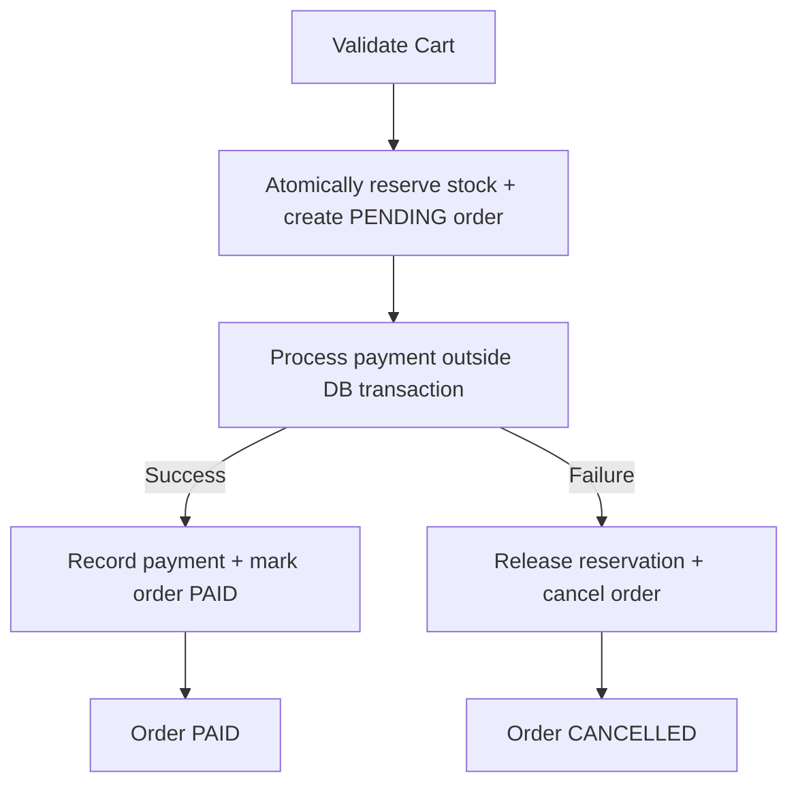
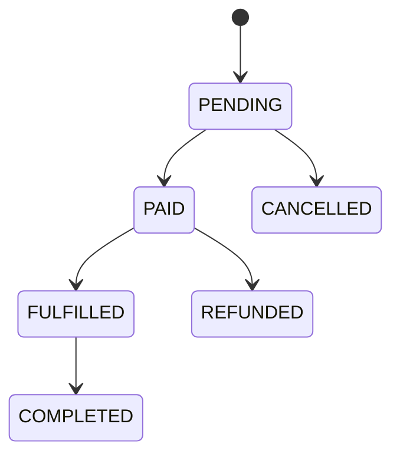

# E-commerce Web API

A backend-only REST API for e-commerce built with **Node.js**, **TypeScript**, **Express**, and **SQL Server** via **Prisma ORM**.

## Table of Contents

- [Overview](#overview)
- [Tech Stack](#tech-stack)
- [Architecture](#architecture)
- [Directory Structure](#directory-structure)
- [Domain Modules](#domain-modules)
- [API Design](#api-design)
- [Order Lifecycle](#order-lifecycle)
- [Getting Started](#getting-started)
- [Testing](#testing)

---

## Overview

This project provides a RESTful HTTP API for a full e-commerce backend. It covers the following domain modules:

- **Product Catalog** — browse and manage products
- **Inventory** — stock tracking and reservation
- **Cart** — per-user cart management
- **Checkout** — idempotent checkout flow with stock reservation
- **Orders** — order creation and lifecycle management
- **Payments** — idempotent payment processing
- **User Management** — authentication and account handling

There is no frontend/UI — this is purely a backend API.

---

## Tech Stack

| Layer         | Technology                         |
|---------------|------------------------------------|
| Runtime       | Node.js                            |
| Language      | TypeScript (strict mode)           |
| Framework     | Express                            |
| ORM           | Prisma                             |
| Database      | SQL Server                         |
| Testing       | Jest                               |
| API Spec      | OpenAPI (documented on routes)     |

---

## Architecture

The project follows a **layered architecture** with a strict one-way dependency flow:


### Layer Responsibilities

| Layer          | Responsibility                                                                 |
|----------------|--------------------------------------------------------------------------------|
| **Controller** | Parse & validate HTTP input, call a service, shape the HTTP response. No business logic, no direct DB access. |
| **Service**    | Own business/domain rules, orchestrate repositories.                           |
| **Repository** | The only layer allowed to talk to Prisma Client / the database.                |

---

## Directory Structure

```
ecommerce-webapi-nodejs-typescript/
│
├── prisma/
│   ├── schema.prisma         # Prisma data model & DB connection
│   └── migrations/           # Prisma migration files
│
├── src/
│   ├── config/               # App configuration (env, constants)
│   ├── controllers/          # HTTP request handlers (one per domain)
│   ├── services/             # Business logic & domain rules
│   ├── repositories/         # Data access layer (Prisma queries)
│   ├── dtos/                 # Request/response data transfer objects
│   ├── routes/               # Express route definitions & OpenAPI annotations
│   ├── middlewares/          # Auth, error handling, validation middleware
│   └── utils/                # Shared utilities and helpers
│
├── test/                     # Unit and integration tests (Jest)
│
├── package.json
└── README.md
```

---

## Domain Modules

### Inventory & Stock
- Stock is enforced non-negatively at the database layer using atomic conditional updates.
- Stock is reserved at checkout start and released if payment fails or the session times out.

### Pricing & Discounts
- All prices are computed server-side; client-submitted prices are never trusted.
- Discounts are applied in order: **item-level → cart-level → shipping**, each recorded for auditability.

### Cart
- Product availability and price are validated on every cart mutation, not only at checkout.

### Checkout Flow



- Checkout is **idempotent** — safe to retry using an idempotency key.
- Payment processing uses an idempotency key to prevent double charges on retry.

---

## Order Lifecycle



Any transition not listed above is rejected and logged.

---

## API Design

- All routes are versioned under `/api/v{n}/`, e.g. `/api/v1/products`.
- Endpoints use **plural nouns**: `/api/v1/products`, `/api/v1/orders/:orderId`.
- Standard **success envelope**:
  ```json
  { "data": {}, "meta": {} }
  ```
- Standard **error envelope**:
  ```json
  { "error": { "code": "NOT_FOUND", "message": "Product not found", "details": {} } }
  ```
- HTTP status codes: `200/201/204` success, `400` validation, `401/403` auth, `404` not found, `409` conflict, `500` unexpected.
- Every endpoint is documented with OpenAPI annotations kept in sync with `src/routes/`.

---

## Getting Started

### Prerequisites

- Node.js (LTS recommended)
- SQL Server instance
- `DATABASE_URL` environment variable set

### Installation

```bash
npm install
```

### Database Setup

```bash
npx prisma migrate dev
```

### Run the Server

```bash
npm run dev
```

### Build for Production

```bash
npm run build
npm start
```

---

## Testing

Tests are written with **Jest** and cover both unit and integration scenarios.

```bash
npm test
```

Test files live in the `test/` directory.
