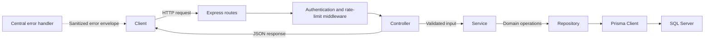
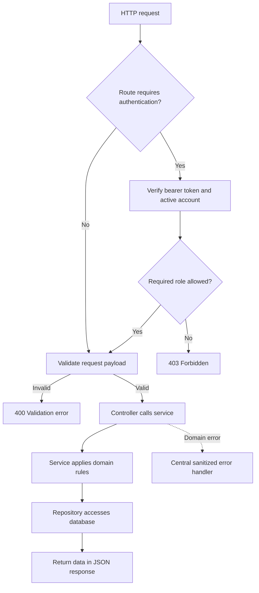
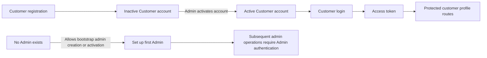

# E-commerce Web API

A backend-only REST API built with **Node.js**, **TypeScript**, **Express**, **Prisma**, and **SQL Server**.

## Table of Contents

- [Project Status](#project-status)
- [Tech Stack](#tech-stack)
- [Architecture](#architecture)
- [Implemented API](#implemented-api)
- [Common Responses and Authentication](#common-responses-and-authentication)
- [Endpoint Reference and Examples](#endpoint-reference-and-examples)
- [Getting Started](#getting-started)
- [Testing](#testing)

## Project Status

The implemented API currently provides a health check and user-management workflows: bootstrap/admin-managed accounts, customer registration and login, customer profile and password management, and admin user search, updates, activation, and deactivation.

Product catalog, inventory, cart, checkout, orders, and payments are project domain goals, not currently implemented API endpoints. Do not rely on routes for those modules until they are added.

## Tech Stack

| Layer | Technology |
| --- | --- |
| Runtime | Node.js |
| Language | TypeScript (strict mode) |
| Framework | Express |
| ORM | Prisma |
| Database | SQL Server |
| Testing | Jest |

## Architecture

Requests pass through Express routes and middleware to controllers. Controllers validate input and shape responses; services enforce user and account rules; repositories are the only layer that accesses Prisma and the database.



Authentication-dependent requests validate the bearer token and then verify the account is still active and has the required role. Admin creation and activation allow bootstrap access only while no Admin account exists.



Customer self-registration creates an inactive account, so an Admin must activate it before the Customer can log in and obtain a token for protected profile routes.



## Implemented API

All endpoints are mounted under `/api/v1`. The complete route inventory and example workloads are below.

### Common Responses and Authentication

Successful resource responses use a `data` property. The admin user list also includes `meta` pagination data. Errors use this envelope:

```json
{
  "error": {
    "code": "VALIDATION_ERROR",
    "message": "Validation failed",
    "details": [
      { "path": ["email"], "message": "Email must be a valid email address" }
    ]
  }
}
```

Server errors use `INTERNAL_ERROR` and the generic message `An unexpected error occurred`; internal details are not returned. Common error codes include `VALIDATION_ERROR` (400), `UNAUTHORIZED` (401), `FORBIDDEN` (403), `NOT_FOUND` (404), `CONFLICT` (409), and `TOO_MANY_REQUESTS` (429).

For authenticated routes, set `ADMIN_AUTH_HEADER` or `CUSTOMER_AUTH_HEADER` to a bearer header containing the appropriate issued token. These environment-variable placeholders are not credentials. The current API does not expose a separate Admin login endpoint. Customer login is rate-limited to 5 requests per minute; customer profile routes to 60 per minute; password change and admin write operations to 5 and 20 per minute respectively.

User responses contain `id`, `firstName`, `lastName`, `email`, `mobileNumber`, `role`, `isActive`, `deactivatedAt`, `createdAt`, and `updatedAt`. Passwords, password hashes, and access tokens are never included in user records.

Passwords used during registration and account creation must be 8–24 characters and contain at least one letter and one number. Mobile numbers must be in E.164 format, for example `+15550000001`. Write schemas reject unknown fields. Examples use fictional values only.

## Endpoint Reference and Examples

### `GET /health`

Public health probe. Returns `200`.

```sh
curl -i "$API_URL/api/v1/health"
```

```json
{ "data": { "status": "ok" } }
```

### `GET /admin/users`

Admin-only paginated user search. Query parameters: `page` (default 1), `limit` (default 20, maximum 100), `search` (matches first name, last name, or email), `role` (`Admin` or `Customer`), and `isActive` (`true` or `false`). Returns `200`; invalid query values return `400`.

```sh
curl -i "$API_URL/api/v1/admin/users?page=1&limit=20&role=Customer&isActive=true" \
  -H "Authorization: ${ADMIN_AUTH_HEADER}"
```

```json
{
  "data": [
    {
      "id": 42,
      "firstName": "Alex",
      "lastName": "Example",
      "email": "alex@example.invalid",
      "mobileNumber": "+15550000001",
      "role": "Customer",
      "isActive": true,
      "deactivatedAt": null,
      "createdAt": "2026-01-15T10:00:00.000Z",
      "updatedAt": "2026-01-15T10:00:00.000Z"
    }
  ],
  "meta": { "page": 1, "limit": 20, "totalItems": 1, "totalPages": 1 }
}
```

### `POST /admin/users`

Create an Admin- or Customer-role account. During bootstrap, this endpoint is unauthenticated only when no Admin account exists; afterward it requires an Admin bearer token. Send `firstName`, `lastName`, `email`, `mobileNumber`, `password`, and `role`. Admin accounts are created active; Customer accounts are created inactive. The client cannot set activation status. Returns `201`; invalid input returns `400`, duplicate email returns `409`, and rate limiting returns `429`.

```sh
curl -i -X POST "$API_URL/api/v1/admin/users" \
  -H "Content-Type: application/json" \
  -H "Authorization: ${ADMIN_AUTH_HEADER}" \
  -d '{
    "firstName": "Alex",
    "lastName": "Example",
    "email": "alex@example.invalid",
    "mobileNumber": "+15550000001",
    "password": "Example123",
    "role": "Customer"
  }'
```

```json
{
  "data": {
    "id": 42,
    "firstName": "Alex",
    "lastName": "Example",
    "email": "alex@example.invalid",
    "mobileNumber": "+15550000001",
    "role": "Customer",
    "isActive": false,
    "deactivatedAt": null,
    "createdAt": "2026-01-15T10:00:00.000Z",
    "updatedAt": "2026-01-15T10:00:00.000Z"
  }
}
```

### `GET /admin/users/{userId}`

Admin-only user lookup. `userId` must be a positive integer. Returns `200`; invalid IDs return `400`, missing users `404`, and unauthenticated/non-Admin callers `401`/`403`.

```sh
curl -i "$API_URL/api/v1/admin/users/42" \
  -H "Authorization: ${ADMIN_AUTH_HEADER}"
```

```json
{
  "data": {
    "id": 42,
    "firstName": "Alex",
    "lastName": "Example",
    "email": "alex@example.invalid",
    "mobileNumber": "+15550000001",
    "role": "Customer",
    "isActive": true,
    "deactivatedAt": null,
    "createdAt": "2026-01-15T10:00:00.000Z",
    "updatedAt": "2026-01-15T10:00:00.000Z"
  }
}
```

### `PUT /admin/users/{userId}`

Admin-only user update. Requires `firstName`, `lastName`, and `mobileNumber`; optionally accepts `password`. Email, role, and activation status are not editable here. Returns `200`; invalid input or ID returns `400`, a missing user returns `404`, and rate limiting returns `429`.

```sh
curl -i -X PUT "$API_URL/api/v1/admin/users/42" \
  -H "Authorization: ${ADMIN_AUTH_HEADER}" \
  -H "Content-Type: application/json" \
  -d '{
    "firstName": "Alexandra",
    "lastName": "Example",
    "mobileNumber": "+15550000001"
  }'
```

```json
{
  "data": {
    "id": 42,
    "firstName": "Alexandra",
    "lastName": "Example",
    "email": "alex@example.invalid",
    "mobileNumber": "+15550000001",
    "role": "Customer",
    "isActive": true,
    "deactivatedAt": null,
    "createdAt": "2026-01-15T10:00:00.000Z",
    "updatedAt": "2026-01-16T10:00:00.000Z"
  }
}
```

### `PATCH /admin/users/{userId}/activate`

Activate an account. While there is no Admin account, authentication is bypassed for bootstrap; otherwise this requires an Admin bearer token. No request body is required. Returns `200`; invalid ID returns `400`, missing user `404`, already-active account `409`, and rate limiting `429`.

```sh
curl -i -X PATCH "$API_URL/api/v1/admin/users/42/activate" \
  -H "Authorization: ${ADMIN_AUTH_HEADER}"
```

```json
{
  "data": {
    "id": 42,
    "firstName": "Alex",
    "lastName": "Example",
    "email": "alex@example.invalid",
    "mobileNumber": "+15550000001",
    "role": "Customer",
    "isActive": true,
    "deactivatedAt": null,
    "createdAt": "2026-01-15T10:00:00.000Z",
    "updatedAt": "2026-01-16T10:00:00.000Z"
  }
}
```

### `PATCH /admin/users/{userId}/deactivate`

Admin-only account deactivation. No request body is required. An Admin cannot deactivate their own account, and the last active Admin cannot be deactivated. Returns `200`; invalid ID returns `400`, missing user `404`, self-deactivation or non-Admin role `403`, inactive account or last-Admin constraint `409`, and rate limiting `429`.

```sh
curl -i -X PATCH "$API_URL/api/v1/admin/users/42/deactivate" \
  -H "Authorization: ${ADMIN_AUTH_HEADER}"
```

```json
{
  "data": {
    "id": 42,
    "firstName": "Alex",
    "lastName": "Example",
    "email": "alex@example.invalid",
    "mobileNumber": "+15550000001",
    "role": "Customer",
    "isActive": false,
    "deactivatedAt": null,
    "createdAt": "2026-01-15T10:00:00.000Z",
    "updatedAt": "2026-01-16T10:00:00.000Z"
  }
}
```

### `POST /customers/register`

Public Customer self-registration. Requires `firstName`, `lastName`, `email`, `mobileNumber`, and `password`. The server assigns the Customer role and creates the account inactive; clients cannot submit role or activation fields. Returns `201`; invalid input returns `400`, and a duplicate email returns `409`.

```sh
curl -i -X POST "$API_URL/api/v1/customers/register" \
  -H "Content-Type: application/json" \
  -d '{
    "firstName": "Casey",
    "lastName": "Example",
    "email": "casey@example.invalid",
    "mobileNumber": "+15550000002",
    "password": "Example123"
  }'
```

```json
{
  "data": {
    "id": 43,
    "firstName": "Casey",
    "lastName": "Example",
    "email": "casey@example.invalid",
    "mobileNumber": "+15550000002",
    "role": "Customer",
    "isActive": false,
    "deactivatedAt": null,
    "createdAt": "2026-01-15T10:00:00.000Z",
    "updatedAt": "2026-01-15T10:00:00.000Z"
  }
}
```

### `POST /customers/login`

Public Customer login. Requires `email` and `password`. Only active Customer accounts can log in. Returns `200` with an access token; invalid input returns `400`, invalid credentials `401`, inactive or unauthorized accounts `403`, and rate limiting `429`.

```sh
curl -i -X POST "$API_URL/api/v1/customers/login" \
  -H "Content-Type: application/json" \
  -d '{"email":"casey@example.invalid","password":"Example123"}'
```

```json
{
  "data": {
    "accessToken": "<access-token>",
    "tokenType": "Bearer",
    "expiresIn": "<configured-duration>"
  }
}
```

### `GET /customers/me`

Customer-only authenticated profile read. Returns `200`; missing/invalid authentication returns `401`, a non-Customer role returns `403`, and rate limiting returns `429`.

```sh
curl -i "$API_URL/api/v1/customers/me" \
  -H "Authorization: ${CUSTOMER_AUTH_HEADER}"
```

```json
{
  "data": {
    "id": 43,
    "firstName": "Casey",
    "lastName": "Example",
    "email": "casey@example.invalid",
    "mobileNumber": "+15550000002",
    "role": "Customer",
    "isActive": true,
    "deactivatedAt": null,
    "createdAt": "2026-01-15T10:00:00.000Z",
    "updatedAt": "2026-01-15T10:00:00.000Z"
  }
}
```

### `PUT /customers/profile`

Customer-only authenticated profile update. Requires `firstName`, `lastName`, and `mobileNumber`; optionally accepts `password`. Email and role cannot be changed. Returns `200`; invalid input returns `400`, missing/invalid authentication `401`, non-Customer role `403`, missing user `404`, and rate limiting `429`.

```sh
curl -i -X PUT "$API_URL/api/v1/customers/profile" \
  -H "Authorization: ${CUSTOMER_AUTH_HEADER}" \
  -H "Content-Type: application/json" \
  -d '{
    "firstName": "Casey",
    "lastName": "Example",
    "mobileNumber": "+15550000002"
  }'
```

```json
{
  "data": {
    "id": 43,
    "firstName": "Casey",
    "lastName": "Example",
    "email": "casey@example.invalid",
    "mobileNumber": "+15550000002",
    "role": "Customer",
    "isActive": true,
    "deactivatedAt": null,
    "createdAt": "2026-01-15T10:00:00.000Z",
    "updatedAt": "2026-01-16T10:00:00.000Z"
  }
}
```

### `POST /customers/change-password`

Customer-only authenticated password change. Requires `currentPassword` and `newPassword`; the new password follows the password policy and must differ from the current password. Returns `200`; invalid input or password reuse returns `400`, missing/invalid authentication or incorrect current password `401`, non-Customer role `403`, and rate limiting `429`.

```sh
curl -i -X POST "$API_URL/api/v1/customers/change-password" \
  -H "Authorization: ${CUSTOMER_AUTH_HEADER}" \
  -H "Content-Type: application/json" \
  -d '{"currentPassword":"Example123","newPassword":"Example456"}'
```

```json
{ "data": { "message": "Password changed successfully" } }
```

## Getting Started

### Prerequisites

- Node.js (LTS recommended)
- A SQL Server instance
- `DATABASE_URL` and `JWT_SECRET` environment variables

### Install dependencies

```bash
npm install
```

### Set up the database

```bash
npm run prisma:generate
npm run prisma:migrate
```

### Run the development server

```bash
npm run dev
```

The server listens on `PORT` (default `3000`). Set `API_URL` to the server base URL for the curl examples, for example `http://localhost:3000`.

### Build and start for production

```bash
npm run build
npm start
```

## Testing

Tests use Jest and cover unit and integration scenarios.

```bash
npm test
```

Run lint and build checks with:

```bash
npm run lint
npm run build
```
